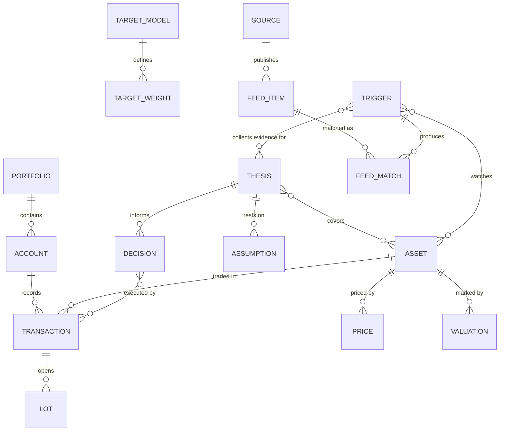
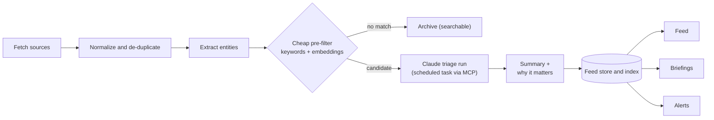
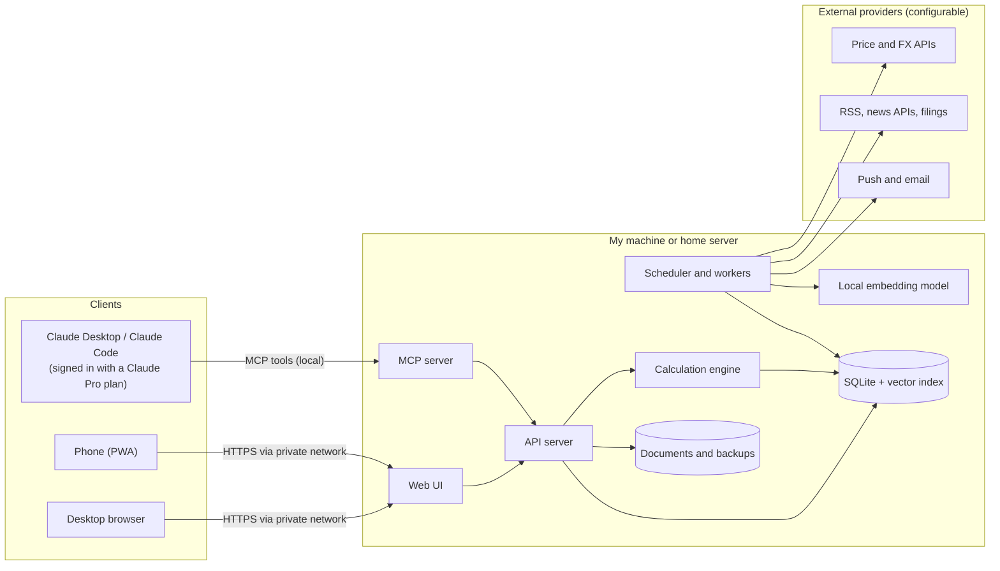

# Portfolio Observer — Requirements

> **Draft v0.2** · 2026-11-03 · Decisions recorded in §14

A private, self-hosted investment cockpit that tracks everything I own, helps me think through investment decisions, and curates the news and signals that matter to my holdings and theses.

**Priority legend**

| Priority | Meaning | Release |
|---|---|---|
| **M** — Must | Required for the platform to be useful | MVP |
| **S** — Should | High value, build right after the MVP | v1 |
| **C** — Could | Nice to have, build once the core is stable | v2+ |

Requirement IDs (e.g. `DASH-03`) are stable so issues, commits and tests can reference them.

---

## 1. Vision and goals

Every time I open the platform it should answer three questions:

1. **Where do I stand?** What do I own across every asset class, what is it worth, and how has it performed?
2. **What should I do?** Which ideas am I acting on, are they still valid, and what does the portfolio need — rebalance, add, trim, exit?
3. **What changed?** What happened in the world that affects my holdings and theses, and why does it matter to me?

### Goals

| ID | Goal |
|---|---|
| G1 | One source of truth for all assets — listed and illiquid — across accounts, currencies and countries. |
| G2 | Correct, explainable performance numbers that are comparable across asset classes. |
| G3 | Structured thinking: explicit theses, assumptions, kill criteria, a decision journal and planning tools. |
| G4 | A low-noise, AI-curated feed tied to my holdings and theses that explains relevance instead of just listing headlines. |
| G5 | Private by default: data stays on hardware I control. |
| G6 | Reusable: anyone can clone the public repository and run it with their own data and API keys. |

### Non-goals

- **Not a broker.** It never places orders, moves money or holds custody. Trades happen elsewhere and are recorded here.
- **Not financial advice.** Analytics and AI output are decision support only.
- **Not a commercial product.** No public sign-up, billing, marketing site or customer support.
- **Not a tax filing tool.** It produces realized-gain and income reports as inputs for an accountant.
- **Not a trading terminal.** End-of-day or delayed prices are enough.
- **Not a net-worth tracker.** Debts and liabilities (mortgages, loans, margin) are not tracked; real estate is shown at gross value (decision D7).

---

## 2. Users and usage scenarios

| User | Context |
|---|---|
| **Owner (primary)** | Single user. Desktop for deep work (theses, analysis, data entry); phone for quick checks, reading the feed, alerts and quick notes. |
| **Trusted viewer (future)** | Partner, advisor or co-investor with read-only access to selected views. |
| **Self-hoster (open source)** | Technical user who clones the repository to track their own portfolio. |

### Key scenarios

1. **Monday check-in (phone, 2 minutes).** See the week's change in total value, top movers, and the five most important news items, each with one line on why it matters to me.
2. **Startup update.** A portfolio company raises a new round. I record the new price per share; MOIC, IRR, allocation and startup-class totals update.
3. **Adding to a position.** I open the thesis, check its assumptions against recent signals, use the rebalancer to size the purchase, and log the decision with my reasoning and confidence.
4. **Quarterly review.** Compare actual vs. target allocation, see drift, generate a plan that only uses new cash, and clear the list of stale valuations and theses due for review.
5. **New theme.** I start a thesis ("European defence spending will grow faster than consensus"), create triggers from it, and receive a weekly AI briefing on evidence for and against.
6. **Year end.** Export realized gains, dividends and interest by account for my accountant.

---

## 3. Principles and constraints

1. **Local-first and private.** Data lives in a local database on my machine or home server. The only outbound traffic goes to providers I configured (prices, FX, news, notifications); portfolio data reaches Claude only through the MCP server, under my data controls.
2. **Correctness over features.** Decimal arithmetic; every number traceable to transactions, prices, FX rates and valuations.
3. **Manual first, automation second.** Every asset can be tracked by hand; integrations are optional accelerators.
4. **Pluggable providers.** Prices, FX, news, importers, notifications and the optional AI API adapter sit behind adapter interfaces.
5. **Graceful degradation.** A missing API key or failing provider never breaks the app; it shows the last known data, marked stale.
6. **Mobile-ready.** Responsive web app, installable on the phone as a PWA.
7. **Open-source hygiene.** No personal data or secrets in the repository; demo data and a one-command setup.
8. **AI through a Claude subscription.** The platform never holds Claude credentials or calls Claude itself. AI work runs inside Claude's own apps (Claude Desktop / Claude Code) signed in with a Claude Pro plan, reading and writing platform data through a local MCP server (§9.6).

---

## 4. Scope and release plan

| Area | MVP | v1 | v2+ |
|---|---|---|---|
| Foundation | Data model, manual entry, CSV, Interactive Brokers and Notion import, documents, prices and FX, backups, login | Reconciliation, recurring transactions, automatic IBKR sync, Gmail/Notion intake via Claude | Other broker/exchange sync |
| Dashboard | Overview, filters, drill-down, value, P&L, TWR, XIRR, MOIC | Benchmarks, attribution, risk metrics, income view, reports | ETF look-through |
| Thesis workspace | Theses, decision journal, targets, drift, rebalancing plans | Thesis health, scenarios, stress tests, AI critic, tax-aware rebalancing | Backtesting, Monte Carlo, optimizer, paper portfolios |
| News and signals | Holding, topic, source and thesis triggers; RSS and a news API; AI relevance and summaries from scheduled Claude runs; feed | Market-event and filing triggers, briefings, push alerts, feedback learning | Newsletter inbox, podcasts/YouTube, story threads |
| AI integration | Local MCP server, scheduled feed triage in Claude Desktop, approval queue | Scheduled briefings, interactive thesis critique and Q&A | Optional Claude API adapter for always-on hosts |
| Access | Responsive PWA over a private network | Offline read | Sharing, multi-user |

**Build order inside the MVP:** Foundation → Dashboard → News feed → Thesis workspace. The dashboard data model is what everything else links to; the feed delivers daily value early; thesis tools get richer once holdings and signals exist.

---

## 5. Domain model

### 5.1 Core entities

| Entity | Purpose | Key attributes |
|---|---|---|
| Portfolio | Top-level container; more than one allowed (e.g. personal, holding company) | name, base currency, owner |
| Account | Where assets are held | institution, type (broker, exchange, wallet, bank, direct/cap table, property, fund), currency, tax wrapper, ownership % |
| Asset | Anything that can be owned | name, class, sub-class, identifiers (ticker, ISIN, contract address, internal id), currency, country, sector, liquidity tier, valuation method, tags |
| Transaction | Any event that changes quantity, cost or cash | date, type, quantity, price, currency, FX rate, fees, taxes, account, asset, source (manual / import / sync), external id, notes |
| Lot | Cost-basis unit opened by a purchase | open date, quantity, cost, remaining quantity |
| Holding | Derived position of an asset in an account (computed, never the source of truth) | quantity, cost basis, value |
| Price | Market price time series | asset, timestamp, price, currency, source |
| Valuation (mark) | Manual or statement-based value for assets without a market price | asset, date, value, method, source, confidence, notes |
| FX rate | Daily currency rates | pair, date, rate, source |
| Benchmark | Index or custom blend for comparison | components, weights |
| Snapshot | Daily materialized values for fast charts (rebuildable) | date, holding, value, cost, flows |
| Thesis | An investment idea and its reasoning | see §7.1 |
| Decision | Decision journal entry | see §7.2 |
| Target model | Target allocation with tolerance bands | see §7.3 |
| Trigger | What the feed follows | see §8.1 |
| Source | Where signals come from | see §8.2 |
| Feed item / match | An ingested item and its relevance to triggers, assets and theses | see §8.3 |
| Tag, note, attachment | Cross-cutting organisation and documents | — |

### 5.2 Asset classes (default taxonomy, fully configurable)

| Class | Examples | Default valuation | Class-specific data and metrics |
|---|---|---|---|
| Public equities and ETFs | Stocks, ETFs, ADRs, REITs | Market price (automatic) | Sector, country, dividend yield |
| Funds | Mutual and index funds | NAV (automatic or manual) | Ongoing charges |
| Fixed income | Government and corporate bonds, T-bills, notes, term deposits | Market price, or amortized cost + accrued interest | Coupon, maturity, YTM, duration, rating |
| Crypto | Coins, tokens, stablecoins, staked positions | Market price (automatic) | Wallet or exchange, chain, staking yield |
| Startups (direct) | Common/preferred shares, SAFEs, convertible notes, options, SPVs and syndicates | Manual mark (last round, write-down) | Stage, round, instrument terms (cap, discount), ownership %, MOIC, IRR |
| Private funds | VC, PE and real-estate fund LP interests | NAV from statements | Commitment, called, distributed, TVPI, DPI |
| Real estate | Residential, commercial, land, crowdfunding | Manual estimate or appraisal | Rent, expenses, rental yield |
| Cash and equivalents | Bank accounts, money market | Balance | Interest rate |
| Commodities | Physical gold and silver, ETCs | Market price or manual | Storage location |
| Other alternatives | Art, watches, wine, P2P loans | Manual | — |

### 5.3 Transaction types

Buy · Sell · Deposit · Withdrawal · Transfer between own accounts (cost basis preserved) · Currency exchange between cash balances · Dividend · Interest · Coupon · Rent income · Distribution · Capital call · Return of capital · Fee · Tax withheld · Expense (e.g. property costs) · Split / reverse split · Spin-off · Merger / identifier change · Conversion (e.g. SAFE or note → equity) · Staking or yield reward · Airdrop · Write-off.

Valuation marks are separate from transactions: they change a holding's value without changing its quantity or cost.

---

## 6. Module 1 — Portfolio dashboard

### 6.1 Data entry and import

| ID | Requirement | P |
|---|---|---|
| DASH-01 | Create, edit and delete portfolios, accounts, assets, transactions and valuations manually. | M |
| DASH-02 | Look up assets by ticker, ISIN, name or crypto symbol and auto-fill metadata (name, currency, exchange, sector, country) from the configured provider; create assets manually when nothing is found. | M |
| DASH-03 | CSV import with a column-mapping wizard, preview, validation, line-level error report and saved mapping templates per institution. | M |
| DASH-04 | Duplicate detection on import (external id or content hash) and one-click rollback of a whole import batch. | M |
| DASH-05 | Cash balances inside brokerage and exchange accounts are tracked, derived from transactions with manual adjustment. | M |
| DASH-06 | Corporate actions: splits and reverse splits. | M |
| DASH-07 | Corporate actions: spin-offs, mergers, ticker/ISIN changes, SAFE and note conversions. | S |
| DASH-08 | Partial ownership: hold an asset or account at a percentage (e.g. 50% of a co-owned flat); all values scale accordingly. | S |
| DASH-09 | Recurring transactions (rent, loan payments, savings plans) generated on schedule for confirmation. | S |
| DASH-10 | Attach documents (SAFEs, term sheets, share certificates, statements, appraisals, deeds) to accounts, assets and transactions — for direct startup deals these are the only records (D5). | M |
| DASH-11 | Reconciliation: enter a statement balance for an account and date; the app shows the difference from its computed holdings. | S |
| DASH-12 | Quick-add on the phone: log a transaction or valuation in under 30 seconds. | S |
| DASH-13 | Read-only sync with other brokers and crypto exchanges (report APIs, read-only exchange keys, aggregators) and public crypto wallet addresses. | C |
| DASH-14 | Gmail and Notion intake: a scheduled Claude task reads investment emails (trade confirmations, investor updates, capital calls, fund statements) through Claude's Gmail connector and investment pages through its Notion connector, and files proposed transactions and valuations into the approval queue (AIX-02). | S |
| DASH-15 | Notion import: one-time import of existing holdings and transactions from Notion database exports (CSV), with a saved mapping template. | M |
| DASH-16 | Interactive Brokers import: built-in template for a Flex Query report (CSV or XML) covering trades, currency conversions, dividends, withholding tax, interest, fees and corporate actions. Its open-positions section feeds reconciliation (DASH-11) and its closing prices serve as a fallback price source. Setup steps for the Flex Query are documented. | M |
| DASH-17 | Automatic daily Interactive Brokers sync through the Flex Web Service (read-only token and query id stored as secrets, SEC-03), with the same de-duplication as file imports. | S |

### 6.2 Pricing and valuation

| ID | Requirement | P |
|---|---|---|
| VAL-01 | Fetch daily closing prices for listed equities, ETFs, funds and crypto automatically, with history back to the first transaction. | M |
| VAL-02 | Fetch daily FX rates and convert every value to the base currency using the rate for that date. | M |
| VAL-03 | Record manual valuation marks for illiquid assets with date, method (last round, write-down, appraisal, fund statement, own estimate), source and notes. Value stays flat between marks. | M |
| VAL-04 | Staleness: every holding shows the date of its last price or mark; per-class thresholds (e.g. 3 days for listed, 6 months for startups, 12 months for real estate) flag stale values and create a review reminder. | M |
| VAL-05 | Provider fallback order per asset class and manual price override per asset. | M |
| VAL-06 | Intraday or delayed price refresh for listed assets and crypto at a configurable interval. | S |
| VAL-07 | Bonds: market price where available, otherwise amortized cost plus accrued interest; coupon and maturity schedule. | S |
| VAL-08 | Startups: apply a round's price per share to a holding; SAFE/convertible conversion calculator (cap, discount); optional illiquidity haircut; write-down and write-off. | S |
| VAL-09 | Real estate: cost = purchase price + transaction costs + improvements; periodic estimate (manual or price-index based); rent and expenses as cash flows. Shown at gross value; mortgages are not tracked (D7). | S |
| VAL-10 | Private funds: commitment, called and uncalled capital, distributions, NAV from statements. | S |
| VAL-11 | Optional interpolation between marks for charts, clearly labelled as estimated. | C |

### 6.3 Performance metrics

| ID | Requirement | P |
|---|---|---|
| PERF-01 | For any selection (portfolio, class, account, tag, holding): market value, cost basis, unrealized P&L (amount and %), realized P&L, income (dividends, interest, coupons, rent, staking), fees and total return. | M |
| PERF-02 | Time-weighted return (TWR) for 1D, 1W, MTD, 1M, 3M, YTD, 1Y, 3Y, 5Y, since inception and custom ranges. | M |
| PERF-03 | Money-weighted return (XIRR) for the same selections and periods. | M |
| PERF-04 | MOIC for private holdings; TVPI, DPI and RVPI for private funds. | M |
| PERF-05 | Returns over one year are shown annualized; shorter periods are never annualized. | M |
| PERF-06 | Toggle to include or exclude illiquid assets from totals, charts and returns. | M |
| PERF-07 | Every metric has a "how is this calculated" explanation and can be traced to the underlying transactions, prices and FX rates. | M |
| PERF-08 | Currency effect: split return into local-currency return and FX impact. | S |
| PERF-09 | Benchmark comparison against chosen indices or a custom blend, for the total and each class. | S |
| PERF-10 | Contribution analysis: which holdings and classes drove the return in a period. | S |
| PERF-11 | Risk metrics for the liquid part: volatility, max drawdown, Sharpe and Sortino ratios, beta to benchmark, correlation matrix. | S |
| PERF-12 | Concentration and exposure: largest positions, position-size warnings, exposure by sector, region and currency. | S |
| PERF-13 | Look-through exposure for ETFs and funds using their published holdings. | C |

### 6.4 Views and navigation

| ID | Requirement | P |
|---|---|---|
| VIEW-01 | **Overview:** total value, change over the selected period, value-over-time chart, allocation by class (donut or treemap), top movers, stale valuations, upcoming events, top feed items. | M |
| VIEW-02 | **Global filter bar:** asset class, account, currency, region, sector, tag, liquidity, thesis and period. Filters apply to every widget and are kept in the URL so views can be bookmarked. | M |
| VIEW-03 | **Asset-class page** with class-specific columns — bonds: coupon, maturity, YTM; crypto: wallet/exchange, staking; startups: stage, last round date, MOIC, IRR; real estate: rental yield, cost vs. latest estimate. | M |
| VIEW-04 | **Holdings table:** sortable, searchable, configurable columns, grouping by class/account/tag, CSV export. | M |
| VIEW-05 | **Holding detail:** price and value chart with buy/sell markers, position summary, lots, transactions, valuation history, income, notes, documents, linked theses, decisions and related feed items. | M |
| VIEW-06 | **Account view:** holdings and cash per account, account-level performance. | M |
| VIEW-07 | **Privacy mode:** one tap hides amounts and shows only percentages. | S |
| VIEW-08 | **Event calendar:** dividends, coupons, maturities, earnings dates, capital calls, lease dates, valuation and thesis reviews. | S |
| VIEW-09 | **Income view:** monthly and yearly passive income by source, plus a forward 12-month estimate. | S |
| VIEW-10 | ~~Net worth view including liabilities~~ — dropped by decision D7. | — |
| VIEW-11 | **Watchlist** for assets I don't own yet, with price, linked theses and feed. | S |

### 6.5 Reports and export

| ID | Requirement | P |
|---|---|---|
| REP-01 | Full data export (JSON and per-table CSV) and restore from that export. | M |
| REP-02 | Realized gains and income report per year and account, with configurable lot method (FIFO default). Informational only. | S |
| REP-03 | Periodic portfolio report (monthly, quarterly, yearly) as HTML/PDF: performance, allocation, changes, income, decisions made. | S |

---

## 7. Module 2 — Thesis workspace

### 7.1 Theses

| ID | Requirement | P |
|---|---|---|
| THS-01 | Create a thesis with title, one-sentence statement, narrative (Markdown), type (single asset, theme/sector, macro, allocation strategy), time horizon, conviction (1–5) and status: Idea → Researching → Active → Under review → Closed (validated / invalidated / abandoned). | M |
| THS-02 | Structured parts: key assumptions, catalysts with expected dates, risks (likelihood × impact), kill criteria (conditions under which I exit), target entry/exit prices or valuation range. | M |
| THS-03 | Link a thesis to holdings, watchlist assets and triggers; an asset may have several theses. | M |
| THS-04 | Review date with reminder; each review adds a log entry ("what changed, what I concluded"). | M |
| THS-05 | Each assumption has a status (holding / weakening / broken) and linked evidence (feed items, notes, documents). | S |
| THS-06 | Thesis health panel: performance since thesis start, supporting vs. contradicting signals per assumption, warning when a measurable kill criterion (price, metric) is hit. | S |
| THS-07 | Version history for each thesis, to see how my thinking evolved. | S |
| THS-08 | Templates per type: public equity (moat, management, valuation), startup (team, market, traction, terms), real estate (location, yield, financing), crypto (adoption, tokenomics), macro. | S |
| THS-09 | Upload research (reports, filings, pitch decks) and get an AI summary linked to the thesis. | C |

### 7.2 Decision journal

| ID | Requirement | P |
|---|---|---|
| DEC-01 | Log a decision: date, asset/thesis, action (buy, add, trim, sell, hold, pass), size, reasoning, expected outcome and horizon, confidence %, alternatives considered, optional mood. | M |
| DEC-02 | Link a decision to the transactions that executed it; suggest the link when a matching transaction is entered or imported. | M |
| DEC-03 | Outcome review at the chosen horizon: rate outcome and decision quality separately; statistics on hit rate and confidence calibration. | S |
| DEC-04 | Personal rules (e.g. "no single position above 10%", "crypto at most 15%") are checked continuously and in every rebalancing plan; violations are flagged. | S |

### 7.3 Target allocation and rebalancing

| ID | Requirement | P |
|---|---|---|
| REB-01 | Define target allocation at class, sub-class and holding level as percentages with tolerance bands. | M |
| REB-02 | Drift view: current vs. target in % and in base currency, with out-of-band items highlighted. | M |
| REB-03 | Rebalancing plan generator with modes: full rebalance, back to band edge, invest new cash only, raise a cash amount. | M |
| REB-04 | Plan constraints: illiquid assets are not tradable, minimum trade size, whole vs. fractional units, locked holdings, per-account restrictions. | M |
| REB-05 | Plans are proposals only: export as a checklist; after executing elsewhere I record the transactions and mark the plan done. | M |
| REB-06 | Multiple named target models (e.g. "Current", "Defensive 2027") compared side by side. | S |
| REB-07 | Cost- and tax-aware plans: estimated fees and realized gains per plan (FIFO lots), tax-loss harvesting opportunities flagged. | S |
| REB-08 | Allocation optimizer: suggest weights that maximize expected return for a chosen risk level (or minimize risk for a target return) within my constraints and rules, with clear warnings that inputs are estimates. | C |

### 7.4 Scenarios, stress tests and projections

| ID | Requirement | P |
|---|---|---|
| SCN-01 | What-if shocks (e.g. equities −30%, BTC +50%, EUR/USD −10%, startup X to zero) with impact by class and in total. | S |
| SCN-02 | Bull, base and bear cases per thesis with probabilities, giving expected value and risk/reward. | S |
| SCN-03 | Historical stress tests (2008, 2020, 2022) applied to the current allocation using class proxies. | S |
| SCN-04 | Monte Carlo projection of future value with contributions and withdrawals; probability of reaching a goal (amount by date). | C |
| SCN-05 | Backtest an allocation and rebalancing rule over history for assets with price data: CAGR, volatility, max drawdown, Sharpe vs. benchmark; warnings about survivorship bias and proxied illiquid assets. | C |
| SCN-06 | Paper portfolios: track a hypothetical position or model from a date and compare it with the real portfolio. | C |
| SCN-07 | Position-sizing helper (e.g. capped fractional Kelly, max-loss based) using the thesis's expected value. | C |

### 7.5 AI thinking partner

| ID | Requirement | P |
|---|---|---|
| AI-01 | Guardrails whenever AI is enabled: AI never records transactions without my confirmation and never trades; all AI output is labelled; factual claims cite feed items or documents; numbers come from the calculation engine, not from Claude. | M |
| AI-02 | Red-team a thesis: challenge assumptions, list missing risks, base rates and counter-arguments, and state what evidence would change the conclusion. | S |
| AI-03 | Evidence brief: summarize feed items since the last review, grouped by assumption, supporting vs. contradicting. | S |
| AI-04 | Natural-language questions about my portfolio ("What is my US tech exposure including ETFs?", "Which theses haven't I reviewed in 6 months?"), answered with data from the calculation engine. | S |
| AI-05 | Guided interview that turns a rough idea into a structured thesis draft. | C |

---

## 8. Module 3 — News and signals feed

### 8.1 Triggers

| ID | Requirement | P |
|---|---|---|
| TRG-01 | **Holding trigger** created automatically for every holding (name, ticker, aliases); can be muted. | M |
| TRG-02 | **Topic trigger:** keyword query (AND / OR / NOT, phrases) plus a plain-language description used for semantic matching (e.g. "EU defence procurement budgets and contracts"). | M |
| TRG-03 | **Source trigger:** follow a specific publisher — think tank, central bank, blog, Substack, analyst. | M |
| TRG-04 | **Thesis trigger:** generated from a thesis's assumptions, catalysts and risks; matches are attached to the thesis. | M |
| TRG-05 | Per-trigger settings: priority, relevance threshold, included/excluded sources, languages, notification channel, digest frequency, pause, expiry date. | M |
| TRG-06 | **Market-event trigger:** daily move above X%, price crossing a level, 52-week high/low, unusual volume. | S |
| TRG-07 | **Filing and event trigger:** regulatory filings (e.g. SEC 8-K, 10-Q, insider transactions), earnings dates, dividend announcements, funding-round news. | S |
| TRG-08 | **Person trigger:** executives, founders, investors, policymakers. | S |
| TRG-09 | AI-assisted setup: describe an interest in plain language and get proposed keywords, entities, sources and threshold, with a preview of what would have matched in the last 30 days. | S |
| TRG-10 | Feedback learning: thumbs up/down, "not relevant" and "more like this" tune relevance for that trigger. | S |
| TRG-11 | **Macro trigger:** scheduled data releases and central-bank decisions (inflation, rates, employment). | C |

### 8.2 Sources and ingestion

| ID | Requirement | P |
|---|---|---|
| SRC-01 | RSS/Atom ingestion (covers most think tanks, central banks, blogs, Substack and many news outlets). | M |
| SRC-02 | At least one general or financial news API through the provider adapter. | M |
| SRC-03 | Source registry: name, URL, type, language, my credibility rating, polling interval, health (last success, error count). | M |
| SRC-04 | Background scheduler with per-source intervals that catches up after the machine was asleep or offline. | M |
| SRC-05 | Respect publishers' terms, robots.txt and API limits; store metadata, summary and link; keep full text only for private analysis where permitted, never republish it. | M |
| SRC-06 | Editable starter source pack: central banks (e.g. ECB, Fed, BIS), international bodies (e.g. IMF, OECD, World Bank) and think tanks (e.g. Bruegel, PIIE, Brookings, CFR, Chatham House, RAND), wherever they publish feeds. | S |
| SRC-07 | Regulatory filings (e.g. SEC EDGAR), company press releases and IR pages, crypto news, and configurable community sources (e.g. Hacker News, Reddit). | S |
| SRC-08 | Newsletter inbox: forward newsletters to a dedicated address and have them parsed into feed items. | C |
| SRC-09 | Podcasts and YouTube via transcripts. | C |

### 8.3 Processing pipeline

| ID | Requirement | P |
|---|---|---|
| PIPE-01 | Normalize and de-duplicate items (canonical URL, near-duplicate text); the same story from many outlets appears once with "+N sources". | M |
| PIPE-02 | Extract entities (companies, tickers, people, countries) and map them to assets and triggers. | M |
| PIPE-03 | Two-stage matching: a free keyword and local-embedding pre-filter runs in the platform; only candidates above a threshold are queued for Claude scoring in the next scheduled triage run (AIX-03). | M |
| PIPE-04 | Each match stores: matched triggers, assets and theses; relevance (0–100); importance (low / medium / high / critical); a 1–3 sentence summary; "why this matters to you"; impact direction for the asset (positive / negative / neutral / mixed); event type (earnings, M&A, regulation, leadership, funding, macro, …). | M |
| PIPE-05 | The feed keeps working without AI: queued items show their keyword/embedding match and source until a triage run scores them, so a skipped run (computer asleep, plan limit reached) delays summaries but breaks nothing. | M |
| PIPE-06 | For thesis matches, classify the item as supporting, contradicting or neutral for each assumption. | S |
| PIPE-07 | Semantic search over everything ingested (local vector index). | S |
| PIPE-08 | Story threads: follow a developing story over days as one item with a timeline. | C |

### 8.4 Feed experience

| ID | Requirement | P |
|---|---|---|
| FEED-01 | Unified feed ranked by importance × relevance × recency, with a chronological alternative. | M |
| FEED-02 | Feed views per trigger, holding, asset class, thesis and source; unread and saved filters. | M |
| FEED-03 | Item card: title, source, time, summary, why it matters, linked holding and thesis chips, impact badge, link to the original. | M |
| FEED-04 | Actions: save, dismiss, mark read, relevance feedback, add to a thesis as evidence, start a decision journal entry, mute a source or topic. | M |
| FEED-05 | Daily and weekly AI briefing: top developments per holding and thesis, portfolio-level implications, items needing action. | S |
| FEED-06 | Notifications (web push to the phone, email, optionally a chat app) for critical items and market-event triggers, with quiet hours, per-trigger channels and rate limits. | S |
| FEED-07 | Full-text search across feed items. | S |
| FEED-08 | Long-report reader: summarize long PDFs (e.g. think-tank reports) into key points and their relevance to me. | C |

---

## 9. Cross-cutting requirements

### 9.1 Platform and access

| ID | Requirement | P |
|---|---|---|
| PLAT-01 | Web app, responsive from 360 px phone width to large desktop screens. | M |
| PLAT-02 | Installable on the phone as a PWA. | M |
| PLAT-03 | One-command start on my machine (e.g. `docker compose up`); macOS and Linux supported, Windows via Docker. | M |
| PLAT-04 | Phone access without exposing the app to the public internet, through a private network (e.g. Tailscale or WireGuard) to the host; setup documented. | M |
| PLAT-05 | Offline read of the last loaded dashboard and saved feed items on the phone. | S |
| PLAT-06 | Documented always-on deployment (home server, NAS, mini PC or small VPS) so ingestion and alerts continue while the laptop sleeps. | S |
| PLAT-07 | Light and dark themes; keyboard shortcuts on desktop. | S |

### 9.2 Security and privacy

| ID | Requirement | P |
|---|---|---|
| SEC-01 | Login required for any access other than from localhost: single-user password with optional TOTP or passkey; configurable session timeout. | M |
| SEC-02 | HTTPS for all non-localhost access. | M |
| SEC-03 | Secrets (API keys) never in the repository; loaded from a git-ignored `.env` or the OS keychain; masked in the UI. | M |
| SEC-04 | Data at rest protected: full-disk encryption documented as the minimum; backups always encrypted. | M |
| SEC-05 | No telemetry or analytics; outbound calls only to configured providers. | M |
| SEC-06 | AI data controls: choose what the MCP server exposes to Claude (full amounts / percentages only / no portfolio data). | M |
| SEC-07 | Application-level database encryption. | S |
| SEC-08 | Audit log of data changes (what, when, by whom) — also the foundation for multi-user. | S |
| SEC-09 | Outbound activity page listing which providers were called and what categories of data were sent. | C |

### 9.3 Data integrity

| ID | Requirement | P |
|---|---|---|
| DATA-01 | Decimal arithmetic for money and quantities; crypto quantities with up to 18 decimal places. | M |
| DATA-02 | Timestamps stored in UTC; trade dates stored as local dates; daily prices aligned to each market's calendar. | M |
| DATA-03 | All derived data (holdings, snapshots, metrics) can be rebuilt from source records. | M |
| DATA-04 | Automatic daily encrypted backup with retention (e.g. 7 daily, 4 weekly, 12 monthly) to a configurable location; documented and tested restore. | M |
| DATA-05 | Versioned schema migrations; upgrades never lose data; automatic backup before each migration. | M |
| DATA-06 | Validation and warnings: negative quantities, prices far from market ("fat finger"), transactions before an asset's first trading date, missing FX rates. | M |

### 9.4 Performance and reliability

| ID | Requirement | P |
|---|---|---|
| NFR-01 | Dashboard renders in under 2 s on desktop and under 3 s on the phone for 300 holdings, 20,000 transactions and 10 years of daily history. | M |
| NFR-02 | Adding or editing a transaction updates the affected numbers within 1 s. | M |
| NFR-03 | Ingestion handles at least 2,000 incoming items per day on a laptop. | M |
| NFR-04 | Provider failures are isolated, with retries and backoff; one failing provider never breaks the UI. | M |
| NFR-05 | Status page: last successful price and FX update per provider, ingestion queue, source errors, last AI triage run, items scored today vs. cap and triage backlog, last backup. | M |

### 9.5 Open-source readiness

| ID | Requirement | P |
|---|---|---|
| OSS-01 | Adapter interfaces for price, FX, news source, LLM, importer and notifier; a new provider can be added without changing core code. | M |
| OSS-02 | Demo mode with a realistic fake portfolio and feed. | M |
| OSS-03 | Configurable base currency, locale (number and date formats), asset-class taxonomy and fiscal year. | M |
| OSS-04 | Personal data directory git-ignored; secret scanning in pre-commit hooks and CI. | M |
| OSS-05 | README (setup, configuration, providers and keys, privacy model, "not financial advice" disclaimer), LICENSE and CONTRIBUTING. | M |
| OSS-06 | Automated tests for the calculation engine with reference cases (TWR, XIRR, lots, FX, corporate actions), run in CI. | M |
| OSS-07 | Works out of the box with free-tier providers only; AI features optional. | S |

### 9.6 AI integration (Claude Pro plan)

The platform runs no AI itself. Claude Desktop and Claude Code — signed in with a Claude Pro plan — do the AI work by calling tools on a local MCP server that the platform exposes. The Pro plan does not include Claude API access, and Anthropic does not allow apps to route requests through subscription logins, so this is the supported way to use the plan. Usage counts against the Pro plan's 5-hour and weekly limits, which are shared with everyday Claude chats, and local scheduled tasks only run while Claude Desktop is open and the computer is awake.

| ID | Requirement | P |
|---|---|---|
| AIX-01 | Local MCP server with read tools: portfolio summary, holdings, performance, theses, triggers and queued feed candidates. Results respect the data controls in SEC-06. | M |
| AIX-02 | Write tools only add annotations or proposals: feed scores and summaries, briefings, thesis notes, and proposed transactions, valuations and triggers. Proposals wait in an approval queue in the UI; nothing financial is recorded without my confirmation. | M |
| AIX-03 | Feed triage runs as a Claude Desktop local scheduled task (e.g. hourly while the computer is awake, plus Desktop's catch-up run after sleep): fetch queued candidates in batches, score and summarize them (PIPE-04), write the results back. The repository ships the task prompt and setup steps. | M |
| AIX-04 | Usage caps: configurable maximum candidates per run and per day, compact payloads (title, snippet, matched holding/thesis context), and a backlog that ages out low-priority items, to stay well inside the Pro plan limits. | M |
| AIX-05 | The platform never asks for, stores or proxies Claude.ai credentials or session tokens. | M |
| AIX-06 | Daily and weekly briefings (FEED-05) and thesis evidence briefs (AI-03) run as scheduled tasks and are saved to the platform. | S |
| AIX-07 | Interactive work — thesis red-teaming (AI-02), portfolio Q&A (AI-04), trigger setup (TRG-09) — happens in Claude Desktop or Claude Code over the same MCP server; the repository ships ready-made prompts or skills for each. | S |
| AIX-08 | Optional Claude API adapter (pay-as-you-go API key, billed separately from any subscription) for self-hosters who want always-on server-side processing. Off by default. | C |

---

## 10. Future: sharing and multi-user

Design for these now, build them later.

| ID | Requirement | P |
|---|---|---|
| FUT-01 | Every record carries an owner/user id and portfolio-level permissions from day one, even with a single user. | M (data model only) |
| FUT-02 | Read-only share links for selected views (e.g. % performance only, no amounts) with expiry and revocation. | C |
| FUT-03 | Multiple users with roles: owner, editor, viewer. | C |
| FUT-04 | Hosted deployment path: Postgres instead of SQLite, managed authentication, per-user data isolation. | C |
| FUT-05 | Household mode: several owners with an ownership % per account or asset. | C |
| FUT-06 | Native mobile wrapper if PWA limits become a problem (notifications, widgets). | C |

---

## 11. Recommended architecture (non-binding)

| Layer | Recommendation | Why |
|---|---|---|
| Frontend | React + TypeScript, PWA, a charting library suited to financial time series | Rich interactive dashboards; one codebase for desktop and phone |
| Backend | Python (FastAPI) | Strongest ecosystem for financial maths, XIRR, backtesting and Monte Carlo (pandas, numpy, scipy) |
| Database | SQLite with migrations, through an ORM that also supports Postgres | Single file, easy backup; clean path to multi-user later |
| Vector search | Embedded local index (e.g. sqlite-vec or LanceDB) with a small local embedding model | Semantic pre-filter and search without another server or paid API |
| Background jobs | In-process scheduler + job table | Price updates, ingestion, briefings, backups |
| AI | Local MCP server; Claude Desktop scheduled tasks and chats on a Claude Pro plan do the AI work (§9.6); optional Claude API adapter | No extra AI bill, no credentials in the app, reuses Claude's Gmail and Notion connectors |
| Deployment | Docker Compose; private network (e.g. Tailscale) for phone access | One command, no public exposure |

Alternative: a single TypeScript stack (e.g. Next.js) — simpler tooling, weaker for the quantitative modules.

### Candidate data providers

Verify current terms, limits and pricing before choosing — these change often.

| Need | Candidates |
|---|---|
| Equity and ETF prices | Twelve Data, Alpha Vantage, Financial Modeling Prep, Finnhub, Tiingo, EOD Historical Data |
| Crypto prices | CoinGecko, CoinMarketCap, exchange public APIs |
| FX | ECB reference rates (e.g. via Frankfurter), Open Exchange Rates |
| Macro data | FRED, ECB Data Portal, Eurostat |
| Filings | SEC EDGAR |
| News | RSS, GDELT, Finnhub company news, Marketaux, NewsAPI |
| Startups | Mostly manual + news; Crunchbase or Dealroom APIs if budget allows |
| Broker data | Interactive Brokers Flex Queries (file import first, then the Flex Web Service); generic CSV for anything else |

Free tiers often cover non-US exchanges poorly — check coverage for the exchanges I actually hold before choosing.

---

## 12. MVP acceptance criteria

The MVP is done when:

1. All current holdings across every class are entered — imported from Interactive Brokers and Notion records, or added manually with their documents — and the initial load takes under 2 hours.
2. The dashboard shows total value in base currency, allocation by class, value over time, and TWR and XIRR for 1M, YTD, 1Y and since inception — filterable by class and account, with drill-down to every holding.
3. Listed securities, crypto and FX update automatically every day; illiquid assets show their last mark and staleness.
4. Numbers reconcile: the Interactive Brokers account matches its statement for a sample month within rounding; TWR and XIRR match a reference spreadsheet for the test cases.
5. I can set target allocations and generate a rebalancing plan, including "new cash only".
6. I can write theses and decision journal entries linked to holdings.
7. The feed has automatic holding triggers plus topic, source and thesis triggers; RSS and one news API; AI summaries with "why it matters" produced by a scheduled Claude task over MCP; per-holding and per-thesis views.
8. The app works on my phone as an installed PWA over a private network, behind login.
9. Daily encrypted backups run and a restore has been tested.
10. Someone else can clone the repository and run it in demo mode without access to my data or keys.

---

## 13. Risks and mitigations

| Risk | Mitigation |
|---|---|
| A market data provider changes terms or limits, or shuts down | Adapter interface, fallback order, manual override, CSV price import |
| Wrong numbers erode trust | Decimal maths, reference tests, reconciliation, "how is this calculated" traces |
| Stale or optimistic marks distort performance | Staleness flags, include/exclude-illiquid toggle, mark method and confidence shown |
| AI hallucination or wrong attribution | Citations, numbers only from the engine, labelled AI output, relevance feedback |
| Noisy feed and alert fatigue | Two-stage matching, thresholds, briefings, rate limits, mute |
| AI usage hits the Pro plan limits (shared with everyday Claude use) | Free local pre-filter, per-run and per-day caps, compact batches, feed still works unscored |
| AI runs pause while the laptop sleeps or Claude Desktop is closed | Catch-up run on wake, backlog with ageing; move to an always-on host with the API adapter (AIX-08) if this becomes a problem |
| Exposure of sensitive financial data | Local-first, private network, login, encryption, AI data controls, no telemetry |
| Scope creep | Strict M/S/C priorities; ship MVP slices before starting v1 items |

---

## 14. Decisions

Settled on 2026-11-03. Items in *italics* are defaults still to be confirmed.

| # | Decision | Outcome | Effect on the requirements |
|---|---|---|---|
| D1 | Base currency | **USD** | All totals and returns reported in USD; FX history loaded against USD. |
| D2 | Where it runs | **Laptop first** | Price updates, ingestion and AI triage run while the Mac is awake and catch up after sleep; always-on hosting (PLAT-06) stays a later option. |
| D3 | Tech stack | **Python (FastAPI) + React/TypeScript** | As in §11. |
| D4 | AI provider and budget | **Claude through a Claude Pro plan — no separate API billing** | The Pro plan has no API access, so the app never calls Claude: AI runs in Claude Desktop / Claude Code over a local MCP server (§9.6). Per-run and per-day caps (AIX-04) replace a dollar budget. |
| D5 | Supported data sources | **Interactive Brokers, direct private deals, Notion records and Gmail statements** | IBKR Flex import (DASH-16) and Notion import (DASH-15) are MVP; daily IBKR sync (DASH-17) and Gmail/Notion intake via Claude (DASH-14) are v1. Startup documents move to the MVP (DASH-10) because direct deals have no platform records. No crypto exchange or wallet sync for now. |
| D6 | Lot method | **FIFO** | Realized gains (REP-02) and rebalancing tax estimates (REB-07) use FIFO. |
| D7 | Liabilities / net worth | **Not tracked** | Liabilities class, loan transactions, net worth view (VIEW-10) and mortgage/LTV fields dropped. |
| D8 | Market data providers | *Open* | Choose once the holdings list shows which exchanges and countries are needed. |
| D9 | Repository licence | *MIT* | Confirm before making the repository public. |
| D10 | Notification channels | *Web push + email* | Confirm when building FEED-06 (v1). |

---

## 15. Glossary

- **TWR (time-weighted return)** — Return that removes the effect of deposit and withdrawal timing. Use it to compare against benchmarks and judge investment selection.
- **XIRR / MWR (money-weighted return)** — Annualized internal rate of return over irregular cash flows; shows how *my money* actually did. Essential for startups, private funds and real estate.
- **MOIC** — Multiple on invested capital: (current value + distributions) ÷ amount invested.
- **TVPI / DPI / RVPI** — Private-fund multiples: total value, distributions and residual value, each divided by paid-in capital.
- **Mark** — A manual or statement-based valuation of an asset without a live market price.
- **Cost basis / lot** — What was paid for a position, tracked per purchase (lot) to calculate realized gains.
- **Drift** — The difference between current and target allocation.
- **Tolerance band** — How much drift is allowed before rebalancing is suggested.
- **Kill criteria** — Conditions, set in advance, under which a thesis is considered wrong and the position should be exited.
- **Look-through** — Seeing the underlying holdings of an ETF or fund to measure true exposure.
- **PWA** — Progressive Web App: a website that installs on a phone's home screen and behaves like an app.
- **MCP (Model Context Protocol)** — An open standard that lets Claude apps call tools provided by other programs; here, the platform's tools for reading portfolio data and saving AI results.
